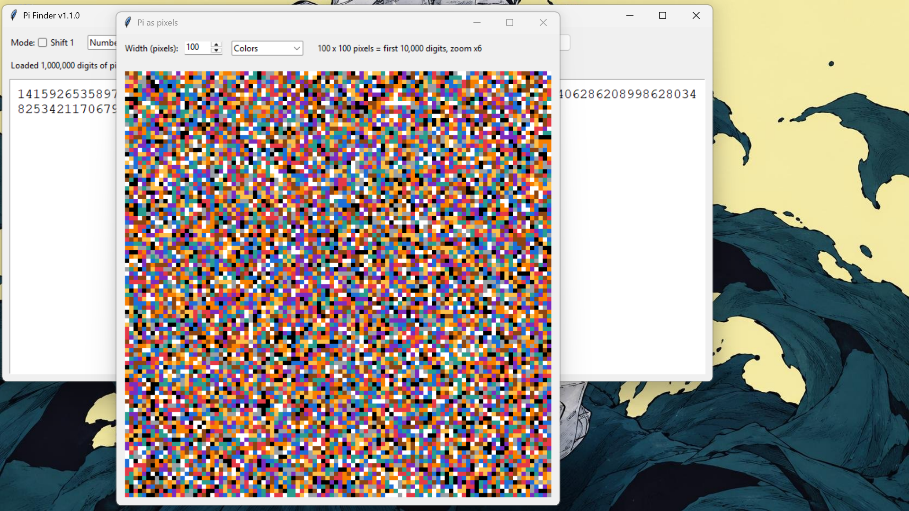
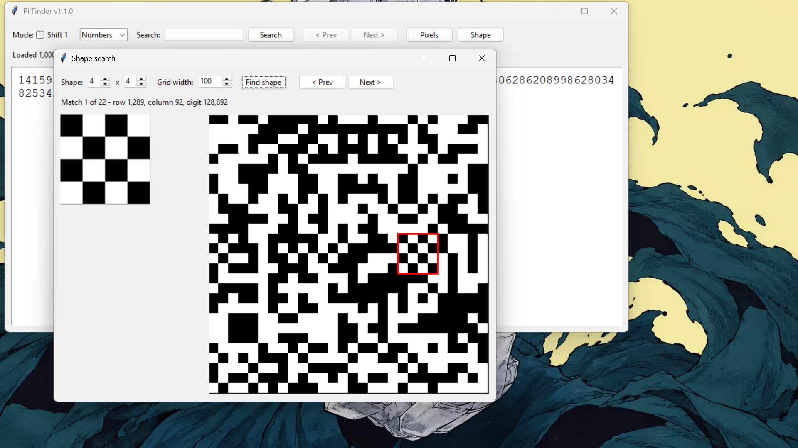

# Pi Finder

A Python desktop app that searches the digits of pi for hidden patterns: numbers, words, pixel pictures and shapes.

## Features
- **Numbers:** search any digit sequence in 1 million digits of pi. Every match is highlighted, and Prev/Next jump between them
- **Letters:** each pair of digits becomes a letter, so you can search for words. A Shift option uses the other pair alignment
- **Pixels:** view the digits as a grid of colored pixels or in black and white
- **Shapes:** draw a black and white shape (2x2 up to 6x6) and find every place it appears in the grid
- **Fast:** the digits are generated at launch with the Chudnovsky algorithm, in the background, so the window opens straight away

## Screenshots

## Examples (first 1 million digits)
- `999999` first appears at digit 762
- In Letters mode: PIE at letter 10,962, CAT at 22,731, DOG at 44,145, MATH at 91,682
- NATE is at letter 161,942, or at 84,252 with Shift on
- At grid width 100, an all-black 3x3 square appears 1,837 times, and a 5x5 never does

## Download (Windows)
1. Go to the [latest release](https://github.com/Nathani21/pi-finder-gui/releases/latest)
2. Download `PiFinder.exe` and double-click it
3. Wait a few seconds for the digits to load, then search!

Windows may warn that it "protected your PC" because the app isn't code-signed. Click **More info**, then **Run anyway**.

## Run from source
1. Install Python 3.11 or newer from python.org (tick "Add Python to PATH" in the installer)
2. On this page, click Code > Download ZIP, then unzip it
3. Open the unzipped folder, type `cmd` in the folder's address bar, press Enter
4. Run: `python pi_finder.py`

## Run the tests